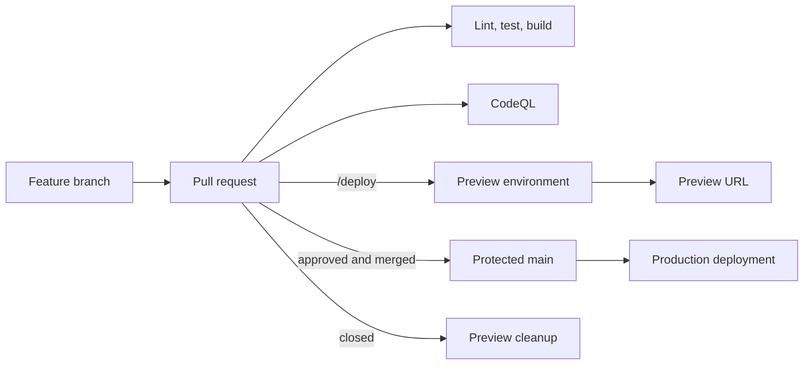

# Next.js CI/CD Production Demo

A public, hands-on demonstration of a production-style CI/CD pipeline for a
Next.js application. The project is being built incrementally so every commit
captures one verified delivery or security improvement.

> **Current status:** the Next.js application baseline is complete. Automated
> validation, deployments, preview environments, and rollback support are the
> next milestones.

## Goal

Build a pipeline where a feature branch is validated in a pull request, can be
deployed to an isolated preview environment on demand, and reaches production
only after its checks pass and it is merged into the protected `main` branch.



## Planned capabilities

- Pull-request linting, tests, type checking, and production builds
- CodeQL static security analysis
- Maintainer-approved `/deploy` preview environments
- Automatic preview cleanup when a pull request closes
- SSH key-based production deployment from protected GitHub environments
- Post-deployment health checks and automatic rollback
- Least-privilege secrets and documented server hardening

Preview deployments will be restricted to trusted, same-repository branches.
Secrets will never be exposed to untrusted forked pull requests.

## Technology

- Next.js 16 with the App Router
- React 19 and TypeScript
- Tailwind CSS
- GitHub Actions
- Linux, Nginx, and PM2 for the production deployment target

## Run locally

Requirements:

- Node.js 20 or later
- npm

```bash
git clone https://github.com/Yousefeslam214/nextjs-cicd-production-demo.git
cd nextjs-cicd-production-demo
npm ci
npm run dev
```

Open <http://localhost:3000>.

## Validate locally

Run the same basic checks that will later run in CI:

```bash
npm run lint
npm run build
```

## Delivery roadmap

- [x] Scaffold a reproducible Next.js application
- [ ] Add pull-request validation
- [ ] Add automated tests
- [ ] Add CodeQL analysis
- [ ] Add secure production deployment
- [ ] Add comment-triggered preview deployments
- [ ] Remove preview environments automatically
- [ ] Add health checks and rollback
- [ ] Add complete architecture, server setup, and troubleshooting guides

## Learning approach

Each capability is introduced in a focused commit, tested in a real deployment
scenario, and documented with the problem it solves. Production-specific
credentials, addresses, domains, and business code are intentionally excluded
from this public repository.

## Security

Do not commit `.env` files, private SSH keys, server addresses, or passwords.
When deployment is introduced, its configuration will use GitHub environment
secrets and a dedicated deployment identity rather than a root password.

## License

A license will be selected before the first stable release. Until then, the
source is available for review as a portfolio and learning project.
